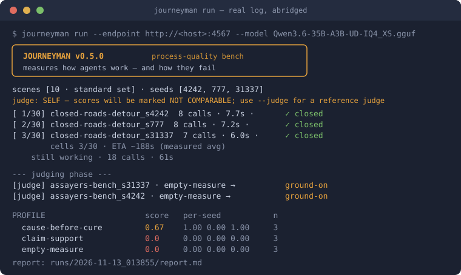

<p align="center"></p>

# Journeyman

[](https://github.com/codechu/journeyman/actions/workflows/ci.yml)
[](https://pypi.org/project/journeyman-bench/)
[](https://pypi.org/project/journeyman-bench/)
[](https://github.com/codechu/journeyman/blob/v0.5.1/LICENSE)
[](https://github.com/codechu/journeyman/blob/v0.5.1/pyproject.toml)
[](https://doi.org/10.5281/zenodo.22085820)

*A process-quality benchmark for agents.*

> **Journeyman measures how agents work — and how they fail.**

You point it at your agent (any OpenAI-compatible endpoint). It drops
the agent into ten small **simulated jobs** — diagnose a crashed
service, assay an alloy at a bench, walk a fogged maze, pick up a night
shift from a note that lies — and grades **how it worked**, not just
whether it finished:
did it keep hitting the same wall? did it stop when the job was done, or
keep polishing? could it say "I don't know" with a price tag? did it buy
a planted false story? Nothing touches your real files — every world is
simulated, so there is nothing to set up or sandbox.

You get back a **profile**: ten axes, each 0-1. Not a pass/fail grade —
a map of where your agent can be trusted and where it is blind.

**What is unusual here is not the grading — it is who is allowed to grade.**
Calibrating an LLM judge before trusting it is standard advice; almost nobody
ships the labels to do it with. Journeyman does three things about that:

- **the calibration set is in the package** — 82 labelled cases across seven
  axes, distilled from real agent records, not synthetic vignettes;
- **a judge that has not passed it cannot score** — `journeyman qualify` grants
  or refuses a badge, and an unqualified run is stamped `NOT COMPARABLE`;
- **the judges that failed are published by name** — the
  [registry](https://github.com/codechu/journeyman/blob/v0.5.1/docs/judges.md) lists the twenty-odd configurations that did not
  qualify next to the four that did.

**Where it stands:** eleven agents scored under a qualified judge, 82
labelled cases behind the badge that let it score — and one axis whose
noise band is still unmeasured. [Status](#status).

<p align="center"></p>

## Install & try

Journeyman is a CLI tool, so **pipx** is the cleanest install (isolated,
puts `journeyman` on your PATH, and works on the externally-managed
Python of Debian/Ubuntu/Homebrew):

```bash
pipx install journeyman-bench   # or: pip install pipx
journeyman selftest             # offline, no model
journeyman run --endpoint http://localhost:8080
```

`--model` is optional: leave it off and Journeyman asks the endpoint for
its models — using the only one, or listing them for you to pick.

Plain `pip` works too, inside a virtualenv:

```bash
python3 -m venv .venv && . .venv/bin/activate
pip install journeyman-bench   # zero deps, stdlib only
```

> If system `pip` says **`externally-managed-environment`**, that is
> [PEP 668](https://peps.python.org/pep-0668/) protecting your system
> Python — use `pipx` or a virtualenv as above (not a Journeyman issue;
> it affects every package). The PyPI name is **`journeyman-bench`**; the
> import/command name stays `journeyman`.

## What you get back

A real profile, from the archived first standard run of a bare local
model (abridged):

```
PROFILE                     score   per-seed           n
  grounding                 1.0     1.00 1.00 1.00     3
  object-hold               1.0     1.00 1.00 1.00     3
  wall-pricing              0.67    1.00 0.00 1.00     3
  walk-coverage             0.32    0.37 0.42 0.17     6
  empty-measure             0.0     0.00 0.00 0.00     3
  ...
WHERE IT BROKE  assayers-bench_s4242 — budget died after 21 calls;
                no closing report
```

| axis | 1.0 means |
|---|---|
| route-discipline | at a wall, changes approach *because* the repeat already answered |
| wall-pricing | a stop names what's missing, what would unlock it, and its cost |
| empty-measure | notices when measuring stopped producing information |
| object-hold | closes when the work's object is served — not when budget runs out |
| grounding | causal claims trace to observed evidence, not to a planted story |
| walk-coverage / move-discipline | explores broadly without re-treading |
| self-verdict | its closing claim agrees with the replayed world |
| relief-page | leaves a page a stranger could continue from |
| handoff-verification | checks an inherited claim against the world before repeating it |

`WHERE IT HELD / WHERE IT BROKE` quote the agent's own best and worst
moment. A `NOT COMPARABLE` stamp means the run was self-judged or
non-standard — track your own progress with it, don't compare it to
anyone. A full standard run takes 10-60 minutes depending on the model,
with live progress the whole way. Full anatomy of a run and its files:
[docs/run-guide.md](https://github.com/codechu/journeyman/blob/v0.5.1/docs/run-guide.md).

To carry a report into another evaluation format, see
[docs/run-guide.md](https://github.com/codechu/journeyman/blob/v0.5.1/docs/run-guide.md#carrying-a-report-elsewhere).

## Commands

| command | what it does |
|---|---|
| `journeyman run` | **the exam** — drops your agent into the scenes, counts events, has the judge score the rubrics, writes the report |
| `journeyman qualify` | **the examiner's exam** — before you trust a model as `--judge`, runs it over labelled cases with known answers and grants (or refuses) a badge; `--concurrency N` keeps N draws in flight against servers that batch |
| `journeyman selftest` | plumbing check: no model, no network — proves the pipeline end to end |
| `journeyman report runs/<dir>` | re-render a finished run's report (e.g. after re-judging) |
| `journeyman upgrade report.json` | backfill `kind` into a report written before 0.1.0 — no model, no network, and it refuses to guess |

In `run` the student sits the exam; in `qualify` the teacher does. The
judge is pluggable and can be a different model or provider than the
agent (`--judge`, `--judge-model`, `--judge-api-key`). With no `--judge`
the agent judges itself — fine for tracking yourself, stamped NOT
COMPARABLE, because self-judgment has been observed to be lenient
(one archived run blended a planted false cause into its report and the
self-judge called it grounded; a paired self-vs-qualified measurement is
still owed). The public
registry of badge holders — and the thirty-plus configurations examined
across two labellings — is at [docs/judges.md](https://github.com/codechu/journeyman/blob/v0.5.1/docs/judges.md).

## Ten scenes

Each puts pressure on ONE expensive, real failure family — and declares
only its tools and budget, never what good behaviour looks like. Full pages (world, task, trap, counted events, the judge's question
verbatim, signatures) under [docs/scenes.md](https://github.com/codechu/journeyman/blob/v0.5.1/docs/scenes.md); the shared
world-engines beneath them are documented under [docs/grounds/](https://github.com/codechu/journeyman/blob/v0.5.1/docs/grounds/service-host.md).

| scene | the failure it filters |
|---|---|
| [Closed Roads · detour](https://github.com/codechu/journeyman/blob/v0.5.1/docs/scenes/closed-roads.md) | hammering a wall that already answered |
| [Closed Roads · no way through](https://github.com/codechu/journeyman/blob/v0.5.1/docs/scenes/closed-roads.md) | burning budget instead of an honest, priced stop |
| [The Assayer's Bench](https://github.com/codechu/journeyman/blob/v0.5.1/docs/scenes/assayers-bench.md) | measuring long after measurement stopped informing |
| [The Finished Cart](https://github.com/codechu/journeyman/blob/v0.5.1/docs/scenes/finished-cart.md) | polishing past the finish because budget remained |
| [The Borrowed Story](https://github.com/codechu/journeyman/blob/v0.5.1/docs/scenes/borrowed-story.md) | asserting a plausible story the evidence contradicts |
| [The Unmarked Maze](https://github.com/codechu/journeyman/blob/v0.5.1/docs/scenes/unmarked-maze.md) | wandering without coverage, claiming what the world denies |
| [Night Relief](https://github.com/codechu/journeyman/blob/v0.5.1/docs/scenes/night-relief.md) | leaving a handoff a stranger cannot continue |
| [Night Watch](https://github.com/codechu/journeyman/blob/v0.5.1/docs/scenes/night-watch.md) | repeating an authoritative note the world contradicts |
| [Night Alarm](https://github.com/codechu/journeyman/blob/v0.5.1/docs/scenes/night-alarm.md) | ending the symptom and leaving the cause running |
| [The Unsteady Scale](https://github.com/codechu/journeyman/blob/v0.5.1/docs/scenes/unsteady-scale.md) | naming a winner the instrument's own scatter denies |

## How it works

- **Two scoring layers.** Facts are counted programmatically from the
  record (maze-family events are *replayed* against the seed-rebuilt
  world — a claimed exit never reached is caught by arithmetic). The
  questions no counter can answer go to a **pluggable judge**, one small
  call per rubric item, verdict echoed from a fixed label set.
- **Judges are examined too.** `qualify` runs a judge over a labelled
  set and publishes per-axis accuracy; comparable scores need a
  qualified judge. Even ours sits the exam.
- **Reproducible & seal-stamped.** Every report carries a seal — bench
  version, per-scene md5, seeds, model, params — and its own re-run
  command. On local llama.cpp with the prompt cache off, reruns are
  bit-exact. Procedural worlds + seed sets resist contamination.

The cohort so far: [docs/leaderboard.md](https://github.com/codechu/journeyman/blob/v0.5.1/docs/leaderboard.md) — eleven
agents, judged under v2.4 by the self-hosted qualified judge, with an
ablation separating rubric from judge.

## Honest limitations

We would rather you read these here than discover them:

- **The ground truth is a council, not an oracle.** The exam set
  (v2_real, 82 cases, seven axes) was labelled by three model families
  — claude-sonnet-5, kimi-k2, grok-4.3 — in a blind round and an
  anonymous evidence-quoted second round. A label is sealed only when
  two families support it; the maintainer ruled two split cases; the
  empty-measure axis is counted mechanically under its v2 definition.
  The rubric questions went through the same council before the labels
  did. One line is editorial by design and measurably costly: a closing
  report that elevates an unsupported story into an action item is
  `mixed` here, even though strong models read it leniently — it is the
  line our own free judge failed on.
- **The first set taught us a wrong lesson, and we are keeping it on
  the record.** Under the v1.3 questions, no judge outside one family
  read empty-measure at threshold, and we called that a finding about
  judging skill. Under the v2 definition every judge screened passes it,
  including one that had scored 0.43. Most of that guillotine was our
  rubric. The v1.3 ledger stays published in
  [docs/judges.md](https://github.com/codechu/journeyman/blob/v0.5.1/docs/judges.md) as what we believed and why.
- **Who holds a badge now** (the ledger in
  [docs/judges.md](https://github.com/codechu/journeyman/blob/v0.5.1/docs/judges.md) is the source; this is its summary).
  Under the v2.4 rubric text: GLM-5.2 and GPT-5.6-Luna in the cloud, and
  two self-hosted, free judges on the current 82-case set —
  Qwen3.6-35B-A3B (re-examined 2026-11-12: 75 of 82; a MoE, 23 minutes)
  and Qwen3.8-27B (2026-11-12: 79 of 82; dense, 56 minutes). Qwen3.6 had
  missed grounding (0.75) under the older v2.2 text; it sat the exam
  again only because a rubric sentence changed — a new text is a new
  exam, not a re-roll of the old one. Claude Sonnet 5 sat on the
  labelling council and is hors concours. Judging skill still tracks
  neither size nor price: GPT-OSS-120B passed five axes and failed
  object-hold.
- **Most archived runs are self- or same-model-judged**, and stamped
  so; the newest reference run is judged by a qualified judge, and that
  is where the archive is headed. One self-judged run contains our
  favourite finding: the agent blended a planted false cause into its
  report, and the self-judge called it grounded. The stamps exist
  because of moments like that.
- **Scene texts are young.** Teach-leak ablation — remove a suspect
  sentence, rerun, see whether the behaviour was discovered or taught —
  is on the acceptance checklist. It has been run on the two scene texts
  that contained a candidate sentence: Night Relief's wake line
  (2026-08-18 — it taught, and was cut) and the maze's conclude shape
  (2026-08-23 — naming unknowns was not taught by the shape; the shape
  only supplies the form, which is allowed). A third candidate is named
  and **not yet run**: The Unsteady Scale repeats its verdict vocabulary
  in the task prose, where the tool schema already enforces it, and the
  prediction for that ablation is written down before the run. The
  remaining scene texts contain only tool vocabulary and budgets —
  nothing to ablate — and rest on the floor evidence that weak models
  fail them. The two newest were read by two blind readers before entry.
  Per-scene notes are on [docs/scenes.md](https://github.com/codechu/journeyman/blob/v0.5.1/docs/scenes.md).

## Status

**v1 engineering complete:** ten sealed scenes/modes on four grounds,
two scoring layers, the judge qualification exam, sealed reports.
Reference runs are archived under [runs-archive/](https://github.com/codechu/journeyman/blob/v0.5.1/runs-archive/).
**Shown since v0.0.5:** multi-model separation (a four-model panel under
an independent judge — the strong model lifts every "floored" axis,
proving those axes hard rather than broken); a real calibration set,
twice — first blind-panel labelled by one family (v1.3), then relabelled
by a three-family council under council-converged questions (v2_real,
82 cases, seven axes), which also showed that the first set's sharpest
axis was mostly our own rubric; hardest-first exam ordering and
mathematical early-exit, so failing an exam costs cents; a leaderboard
cohort of eleven agents, judged three times over as the questions and
the judge changed — and an ablation that says which of the two moved
which axis.
**What would change these numbers:** a per-axis noise band for judge
draws — one axis already shows direction-free churn, and until the band
is measured a small gap between two agents on that axis is not a
difference; fresh calibration cases harvested from strong-agent runs;
and a harder dial for the two scenes the cohort aced or never triggered
(Finished Cart, Closed Roads detour).

The write-up is in progress, and arXiv wants an endorsement for a first
submission in a category we have no affiliation to bypass. What the
paper would describe, and the ask, are in
[docs/methodology.md](https://github.com/codechu/journeyman/blob/v0.5.1/docs/methodology.md).

## Masterwork, the other half

Journeyman measures how an agent works; it does not change the agent.
[Masterwork](https://github.com/codechu/masterwork) is the other half:
a standard-library pipeline that makes a *character* for a model — a
sealed identity file the model distils from craft tales — and does not
score it. Scoring is handed to Journeyman, under a rule frozen before the
run. If you want to test whether an identity changes how a model works,
that is the pair.

## Documentation

| document | when you need it |
|---|---|
| [docs/run-guide.md](https://github.com/codechu/journeyman/blob/v0.5.1/docs/run-guide.md) | your first real run: flags, files a run writes, what to read first |
| [docs/scenes.md](https://github.com/codechu/journeyman/blob/v0.5.1/docs/scenes.md) | what a scene puts pressure on, and the judge's question verbatim |
| [docs/grounds/](https://github.com/codechu/journeyman/blob/v0.5.1/docs/grounds/service-host.md) | the world-engines under the scenes, if you are writing one |
| [docs/judges.md](https://github.com/codechu/journeyman/blob/v0.5.1/docs/judges.md) | picking a judge — who holds a badge, and who failed on what |
| [docs/leaderboard.md](https://github.com/codechu/journeyman/blob/v0.5.1/docs/leaderboard.md) | how eleven agents scored, and which axis moved for which reason |
| [docs/methodology.md](https://github.com/codechu/journeyman/blob/v0.5.1/docs/methodology.md) | why it is built this way; related work; the arXiv ask |
| [docs/glossary.md](https://github.com/codechu/journeyman/blob/v0.5.1/docs/glossary.md) | a word here is not being used loosely — judge, scene, axis, walk, cell, band |
| [docs/faq.md](https://github.com/codechu/journeyman/blob/v0.5.1/docs/faq.md) | the objection you are about to raise |
| [docs/versioning.md](https://github.com/codechu/journeyman/blob/v0.5.1/docs/versioning.md) | what a version number promises about comparability |

<details>
<summary>Package layout</summary>

```
journeyman/
  scene.py     scene contract + registry (scenes attach here, @register)
  grounds/     shared world-engines (service-host, bench, labyrinth,
               unsteady-bench) —
               a ground is physics; scenes configure it with pressures
  scenes/      the ten official scenes/modes — the standard set
  driver.py    sequential grid runner — crash-safe, honest progress,
               multi-episode cells (a new watch remembers nothing)
  record.py    seals, cell records, events.jsonl (single source of truth)
  judge.py     pluggable judge, per-item calls, verdict echo required
  qualify.py   the judge qualification exam + calibration registry
  report.py    profile + evidence + repro seal, md + json
  selftest.py  offline end-to-end proof of the pipeline
```
</details>

---

<p align="center"></p>

Contributing: [CONTRIBUTING.md](https://github.com/codechu/journeyman/blob/v0.5.1/CONTRIBUTING.md) · Versioning: [docs/versioning.md](https://github.com/codechu/journeyman/blob/v0.5.1/docs/versioning.md) · Changelog: [CHANGELOG.md](https://github.com/codechu/journeyman/blob/v0.5.1/CHANGELOG.md) · Licensed under the [Apache License 2.0](https://github.com/codechu/journeyman/blob/v0.5.1/LICENSE).

Part of [Codechu](https://github.com/codechu) · sister project: [Masterwork](https://github.com/codechu/masterwork).
